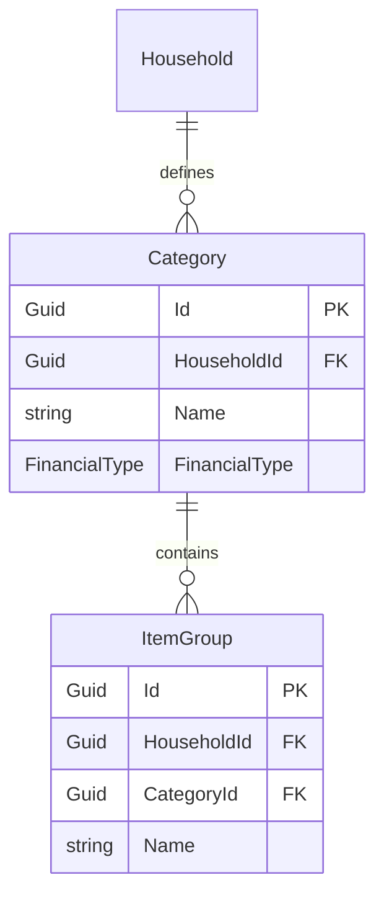

# Classification: categories and item groups

Provider note: this guide records the original SQLite implementation checkpoint.
The domain rules remain in place; PostgreSQL now replaces its provider, migrations
and test infrastructure. See [containers and PostgreSQL](containers-and-postgres.md)
for current mappings and commands.

Implemented locally, 29 October 2026. This slice adds classification only. Tracked
items, household allocations, snapshot entries and API CRUD endpoints follow later.

## Files to review

| File | Responsibility |
| --- | --- |
| [FinancialType.cs](../backend/src/Hearthcast.Data/Classification/FinancialType.cs) | System identifiers Asset and Debt. |
| [Category.cs](../backend/src/Hearthcast.Data/Classification/Category.cs) | Category identity, household, name and financial type. |
| [ItemGroup.cs](../backend/src/Hearthcast.Data/Classification/ItemGroup.cs) | Group identity, household, category and name. |
| [ClassificationService.cs](../backend/src/Hearthcast.Data/Classification/ClassificationService.cs) | Creates categories and groups within the specified household. |
| [CategoryConfiguration.cs](../backend/src/Hearthcast.Data/Persistence/Configurations/CategoryConfiguration.cs) | Category table, financial-type/name checks and household FK. |
| [ItemGroupConfiguration.cs](../backend/src/Hearthcast.Data/Persistence/Configurations/ItemGroupConfiguration.cs) | Group table and composite FK to a category in the same household. |
| [ClassificationPersistenceTests.cs](../backend/tests/Hearthcast.Data.Tests/Classification/ClassificationPersistenceTests.cs) | SQLite persistence, household boundaries, renaming, deletion and migration-upgrade checks. |
| [PostgresTestDatabase.cs](../backend/tests/Hearthcast.Data.Tests/Infrastructure/PostgresTestDatabase.cs) | Current test infrastructure; each test gets its own migrated PostgreSQL database. |

The new migration is `CreateCategoriesAndItemGroups` under
`backend/src/Hearthcast.Data/Persistence/Migrations`.

## Fields and relationships

- All fields are required. Names are user-defined, trimmed and nonblank.
- FinancialType is stored as an integer: Asset = 1, Debt = 2. Zero and undefined
  values are rejected by application validation and a SQLite check constraint.
- A group's financial meaning comes from its category. It has no second
  FinancialType field to configure. Names never determine financial type.
- Category and ItemGroup each have a primary Id and an additional unique
  `(HouseholdId, Id)` key. Names are not unique identifiers.
- Category references HouseholdId with restricted deletion.
- Group references Category through `(HouseholdId, CategoryId)` pointing to
  `(HouseholdId, Id)`. A valid category ID from another household is still invalid
  for the group. This is enforced by SQLite, not just the creation service.
- There is no additional direct group-to-household FK: the required composite
  category link already establishes the household relationship.

## Behaviour

ClassificationService has two creation operations. It checks that the requested
household/category exists within scope, then saves the new entity. It does not
seed category names or infer anything from a name.

Both entities expose a validated Rename method. Renaming preserves IDs, the
category's financial type and existing group relationships. Moving groups between
categories or changing financial types is outside this slice.

Deleting a category referenced by a group is restricted by the FK. Deleting an
unused category is allowed. Tracked items now reference groups with their own
deletion restrictions. There is no automatic cascade deletion or API delete
endpoint in this slice.

## Verification

Classification contributes 28 cases alongside the 21 household cases; later
slices add their own cases. The suite uses actual migrations and isolated SQLite files.

Checks include Asset/Debt round trips, required names, undefined types, missing
parents, same-household enforcement through both the service and raw SQL,
identity-preserving renames, restricted deletion and upgrading the first migration
without losing existing Household/Person records. The existing migration
rollback/reapplication test now checks that all current migrations are applied.

No persistent application database was created or updated. API startup and its
health endpoint remain unchanged. Classification changes remain separate from
the preceding pushed Household/Person checkpoint.
