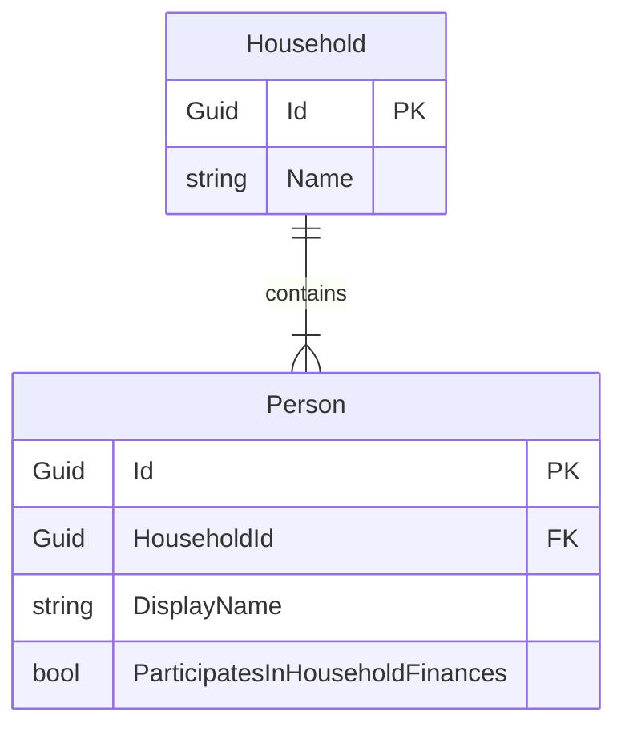

# Household and Person: first persistence slice

Provider note: this guide records the original SQLite implementation checkpoint.
The domain rules remain in place; PostgreSQL now replaces its provider, migrations
and test infrastructure. See [containers and PostgreSQL](containers-and-postgres.md)
for current mappings and commands.

Implemented locally, 28 October 2026. This slice contains two business entities
and stops before classification, balances, snapshots or API CRUD endpoints.

## Files to review

| File | Responsibility |
| --- | --- |
| [Household.cs](../backend/src/Hearthcast.Data/Households/Household.cs) | Household identity/name and membership/participation rules. |
| [Person.cs](../backend/src/Hearthcast.Data/Households/Person.cs) | Person identity, household link, display name and participation flag. |
| [HouseholdConfiguration.cs](../backend/src/Hearthcast.Data/Persistence/Configurations/HouseholdConfiguration.cs) | Household table, name check, required person relationship and deletion restriction. |
| [PersonConfiguration.cs](../backend/src/Hearthcast.Data/Persistence/Configurations/PersonConfiguration.cs) | Person table, required fields, boolean check and household-scoped unique key. |
| [HearthcastDbContext.cs](../backend/src/Hearthcast.Data/Persistence/HearthcastDbContext.cs) | The two sets and their mapping registration. |
| [HouseholdService.cs](../backend/src/Hearthcast.Data/Households/HouseholdService.cs) | Transactional create/add/change-participation/remove operations. |
| [Migrations](../backend/src/Hearthcast.Data/Persistence/Migrations) | Initial migration, generated metadata and EF model snapshot. |
| [HouseholdPersistenceTests.cs](../backend/tests/Hearthcast.Data.Tests/Households/HouseholdPersistenceTests.cs) | Integration checks against migrated temporary SQLite files. |
| [PostgresTestDatabase.cs](../backend/tests/Hearthcast.Data.Tests/Infrastructure/PostgresTestDatabase.cs) | Isolated test-database factory shared with the Classification tests. |

## Tables and relationship



All columns are required. IDs are assigned when records are created. Person has
an additional unique `(HouseholdId, Id)` key for future household-scoped references.
Deleting a household with people is restricted, with no cascade deletion.

## Application rules

- Creation supplies a household name and first person's display name. That
  first person participates in household finances, even with no items recorded.
- Names are trimmed and cannot be null or whitespace.
- Additional people may participate or be excluded from household finances.
- The final person cannot be removed. The final participant cannot be removed
  or switched off. A participant in another household does not satisfy the rule.
- A person's household membership cannot be changed through these operations.

Use HouseholdService for membership and participation writes. Construction and
membership-changing methods are restricted to the data assembly, with read-only
public properties/collections. The service creates a fresh context for each
operation and loads the complete household before changing membership or participation.

Creation saves the household and person together. Updates validate and save
inside a serializable transaction. Fresh tracked state avoids making a decision
using a previously loaded membership list.

The database enforces the FK, required fields, space-blank name checks and boolean
values. Minimum member/participant counts are application rules; direct SQL or
deliberately bypassing the service can bypass those cross-row rules. Application
validation also handles whitespace beyond SQLite's ordinary space trimming.

The [Tracked items slice](tracked-items-slice.md) adds service guards against
excluding/removing allocation recipients and removing actual holders. The
Household entity continues to enforce its own minimum membership/participation rules.

## Migration tooling and verification

EF Core SQLite and the local dotnet-ef tool are pinned to 10.0.13. The API's design
package supports migration tooling; the API itself still serves only `/health`.
There is no runtime database connection configuration or automatic migration.

From the repository root:

```sh
dotnet restore Hearthcast.slnx
dotnet tool restore
dotnet build Hearthcast.slnx --no-restore
dotnet test Hearthcast.slnx --no-build --no-restore
```

Tests use the actual migration, not EnsureCreated or EF's in-memory provider.
The 21 passing cases cover round trips, invalid names, nonparticipating people,
minimum membership and participation, household boundaries, concurrent changes,
creation rollback after an insert failure, SQLite FK/required-field checks and
migration rollback/reapplication with no pending model changes.

To inspect the generated migration SQL without updating a database:

```sh
dotnet ef migrations script --project backend/src/Hearthcast.Data --startup-project backend/src/Hearthcast.Api
```

The design-time factory uses an in-memory SQLite connection for model tooling;
it does not select a persistent application database. Applying a migration to a
file requires explicitly supplying `--connection` to `dotnet ef database update`.
The parent directory must already exist and the connection should enable
`Foreign Keys=True`. No persistent application database was created for this slice.

Implementation follows EF's documented [SaveChanges transaction behaviour](https://learn.microsoft.com/en-us/ef/core/saving/transactions),
[SQLite transaction isolation](https://learn.microsoft.com/en-us/dotnet/standard/data/sqlite/transactions)
and [design-time factory support](https://learn.microsoft.com/en-us/ef/core/cli/dbcontext-creation).
