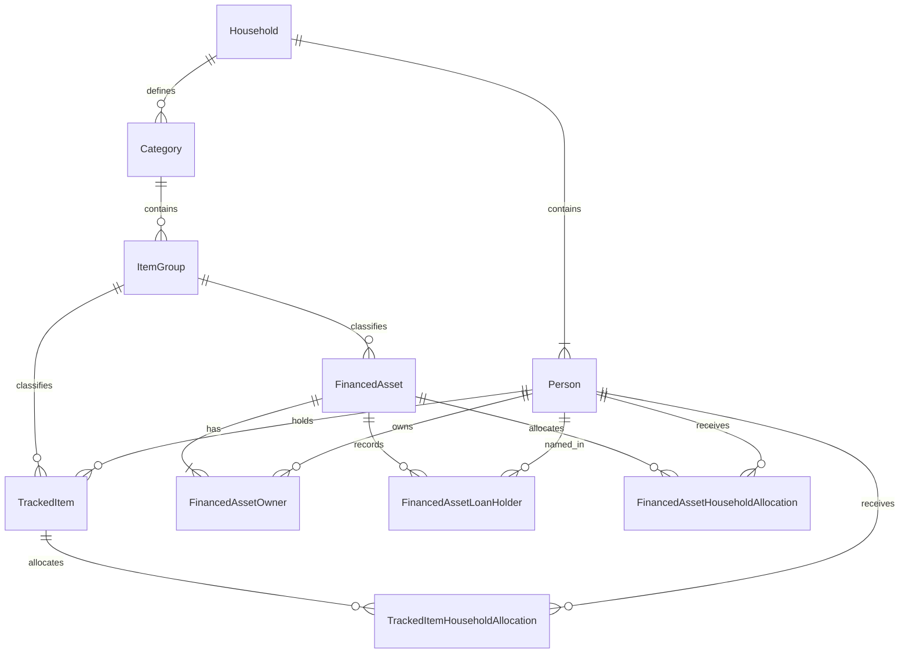
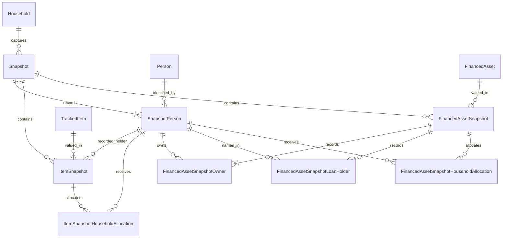

# Hearthcast relational schema and implementation plan

Updated 30 October 2026. This translates the [logical model](schema-proposal.md)
into proposed tables and constraints. The [Household/Person](household-person-slice.md),
[Classification](classification-slice.md), [Tracked items](tracked-items-slice.md)
[Ordinary snapshots](ordinary-snapshots-slice.md) and
[Financed-asset setup](financed-asset-setup-slice.md) slices are implemented.
Other tables and
recommendations remain a plan for review before their entities and migrations
are created.

PostgreSQL now replaces the original SQLite provider and migration chain;
see [containers and PostgreSQL](containers-and-postgres.md) for the current baseline
and verification. Test counts below record their original implementation checkpoints.

Work proceeds in small slices. Each slice ends with a visible diff and relevant
verification. Pushes require explicit user instruction.

## Recommendations before mapping

1. Ordinary tracked items have exactly one named holder. Use a required
   `TrackedItem.HolderPersonId` rather than an ItemHolder join table containing
   only one 100% row. Its saved counterpart is
   `ItemSnapshot.HolderSnapshotPersonId`.
2. Keep household allocation rows separate. An individually held account can
   still be allocated 50/50 within the household.
3. Financed assets get explicit owner, loan-holder and household-allocation
   tables, plus copied snapshot counterparts. Owner shares and household shares
   are independent. Loan-holder rows record names, not a division of legal debt.
4. Add a `HasWithdrawalFacility` flag to financed-asset setup and copy it into each
   financed-asset snapshot. This distinguishes a loan without a withdrawal facility
   from one with an unknown AvailableToWithdraw balance. It is configured once,
   not entered each month.
5. Enforce same-household and same-snapshot relationships through composite
   foreign keys as well as application validation. Globally unique IDs alone
   do not prevent a row from pointing to another household's person.

The direct ordinary holder and same-household item/allocation keys are now
implemented. Remaining recommendations guide later slices; implementation guides
record the currently enforced subset.

## Current setup relationships

Allocation collections are empty for excluded records and required for included
records. Ownership is required even for excluded records. A paid-off financed
asset remains in place; a loan-holder collection can be empty where no loan exists.

| Proposed table | Primary key | Required foreign keys / relationship fields |
| --- | --- | --- |
| Household | Id | None |
| Person | Id | HouseholdId |
| Category | Id | HouseholdId |
| ItemGroup | Id | HouseholdId, CategoryId |
| TrackedItem | Id | HouseholdId, GroupId, HolderPersonId |
| TrackedItemHouseholdAllocation | TrackedItemId + PersonId | HouseholdId, TrackedItemId, PersonId |
| FinancedAsset | Id | HouseholdId, GroupId |
| FinancedAssetOwner | FinancedAssetId + PersonId | HouseholdId, FinancedAssetId, PersonId |
| FinancedAssetLoanHolder | FinancedAssetId + PersonId | HouseholdId, FinancedAssetId, PersonId |
| FinancedAssetHouseholdAllocation | FinancedAssetId + PersonId | HouseholdId, FinancedAssetId, PersonId |

Share-bearing association tables have a required `ShareBasisPoints` integer.
Loan-holder rows have no share field. Other setup metadata is described in the
logical proposal; proposed nullability is listed below.

## Saved snapshot relationships

| Proposed table | Primary key | Required foreign keys / relationship fields |
| --- | --- | --- |
| Snapshot | Id | HouseholdId |
| SnapshotPerson | Id | HouseholdId, SnapshotId, PersonId |
| ItemSnapshot | Id | HouseholdId, SnapshotId, TrackedItemId, HolderSnapshotPersonId, CategoryId, GroupId |
| ItemSnapshotHouseholdAllocation | ItemSnapshotId + SnapshotPersonId | SnapshotId, ItemSnapshotId, SnapshotPersonId |
| FinancedAssetSnapshot | Id | HouseholdId, SnapshotId, FinancedAssetId, CategoryId, GroupId |
| FinancedAssetSnapshotOwner | FinancedAssetSnapshotId + SnapshotPersonId | SnapshotId, FinancedAssetSnapshotId, SnapshotPersonId |
| FinancedAssetSnapshotLoanHolder | FinancedAssetSnapshotId + SnapshotPersonId | SnapshotId, FinancedAssetSnapshotId, SnapshotPersonId |
| FinancedAssetSnapshotHouseholdAllocation | FinancedAssetSnapshotId + SnapshotPersonId | SnapshotId, FinancedAssetSnapshotId, SnapshotPersonId |

Share-bearing snapshot associations copy the original shares. Saved names,
classification, financial type, inclusion and allocations drive reports. Live
identity references connect histories without substituting current settings.

Each of the three financed-asset balances has its own amount, origin and last
confirmation date/precision. These are columns on FinancedAssetSnapshot, not
three more balance tables. Any source-copy reference must also identify the same
financed asset. Optional carry-source references remain provenance; saved amounts
are independent copies.

## Keys, uniqueness and relationship boundaries

- Proposed entity IDs: Guid, stored as PostgreSQL uuid.
- Setup entities referenced across a household boundary have an additional unique
  key `(HouseholdId, Id)`. For example, TrackedItem references
  Person through `(HouseholdId, HolderPersonId)` and ItemGroup through
  `(HouseholdId, GroupId)`. ItemGroup references Category the same way.
- Snapshot has a unique `(HouseholdId, Id)` key. SnapshotPerson, ItemSnapshot and
  FinancedAssetSnapshot link to their parent through that pair and link to their
  original identities within the same household.
- SnapshotPerson has a unique `(SnapshotId, Id)` key. ItemSnapshot's holder
  reference uses `(SnapshotId, HolderSnapshotPersonId)`.
- ItemSnapshot and FinancedAssetSnapshot also expose unique `(SnapshotId, Id)`
  keys. Their association rows reference both their entry and person with the
  same SnapshotId, preventing mixed-snapshot allocations or owners.
- Saved CategoryId/GroupId references stay in the same household, but their
  historical relationship and labels come from saved metadata. Do not enforce
  that an old saved group/category pair matches today's mutable classification.
- Unique `(SnapshotId, PersonId)` on SnapshotPerson.
- Unique `(SnapshotId, TrackedItemId)` on ItemSnapshot.
- Unique `(SnapshotId, FinancedAssetId)` on FinancedAssetSnapshot.
- Carry-source links must point to the same item and an earlier capture. A
  composite FK can enforce matching identity; date order needs application
  validation. Backdated creation must not carry a future balance backwards.
- Names are not globally unique identities. Duplicate-name policy can remain a
  UI concern rather than an accidental database restriction.

## Required values and missing data

- Names, current item group, actual holder/owners, currency, country, inclusion
  flags and participation flags are required. Blank names are invalid.
- Purchase date and purchase price may be null when not known. Original loan
  amount is required and nonnegative in the financed-asset setup slice.
- Snapshot date and Day/Month precision are required. Month-only dates are stored
  as the first day and displayed as a month.
- An ordinary item amount can be null. The same applies independently to current
  financed-asset valuation, outstanding debt and applicable AvailableToWithdraw balance.
- Null is missing, never an inferred zero. Zero is an explicit known amount.
- Recorded monetary inputs are nonnegative; calculated equity or balance reduction
  may be negative and must not be clamped.
- Last confirmation date/precision are nullable together where the source date is
  unknown. A copied known confirmation date retains its original precision.
- Unrecorded values have null amount; confirmed/carried values have an amount.
- When HasWithdrawalFacility is false, its amount and confirmation metadata are empty.
  When true, a null amount indicates missing information. Equity is computable
  without AvailableToWithdraw, but the reduction excluding withdrawable funds
  requires that amount.

## Exact numbers and dates

- Ordinary amount mapping: .NET decimal with native numeric in PostgreSQL,
  preserving exact values. Start with decimal aggregation in application code;
  avoid implicit floating-point conversion. Numeric SQL aggregation is also exact.
- Verify representative amounts and exact round trips. Native numeric needs no
  text converter. The application validates inputs; PostgreSQL also checks amounts
  are nonnegative and finite.
- Store shares as integer basis points, range 1 to 10,000 for present rows.
  Share collections must total exactly 10,000. Omit zero-share rows.
- Use DateOnly for financial dates, with separate precision, and UTC timestamps
  for creation/edit metadata. Do not substitute entry time for financial time.

## Deletion, transactions and application rules

Use Restrict/NoAction for relationships in the initial mapping. Referenced people,
classifications and items cannot be deleted out from under saved history. Retire
items to remove them from new capture lists. Do not introduce soft-delete fields
on every table or an implicit cascade from a household to its history.

Foreign keys and row checks cannot enforce every rule. Transactional application
logic must also enforce:

- Household creation includes its first person and at least one participant.
- Editing/removing people preserves those minimums and resolves current allocations.
- Holder/owner and household shares have the appropriate totals.
- Excluded records have no household allocations; included records have a full
  allocation to eligible participants. Financed assets use an Asset category.
- Current settings and copied historical settings are intentionally independent.
- Saving one complete capture commits its header, roster, item entries,
  financed-asset entries and association rows atomically.
- Correcting an older saved amount does not silently update later copied amounts.

## Implementation slices and review points

1. **Review this relational plan.** Resolve proposed simplifications and nullability.
   No entity generation in this step.
2. **Household and Person.** Add only these entities, their EF mapping and the first
   SQLite migration. Verify a round trip, the FK, required fields, and the
   household/participant creation rule. Inspect the generated migration. This
   slice is implemented locally with 21 passing SQLite integration cases.
3. **Classification.** Category and ItemGroup, including Asset/Debt, required names,
   same-household FKs, renaming and deletion restrictions. Implemented locally;
   28 new cases and the existing 21 household cases pass.
4. **Ordinary items.** TrackedItem and household allocation. Verify household
   boundaries, independent holder/allocation treatment and invalid allocation rejection.
   Implemented locally with 45 new cases; all 94 SQLite cases pass. Participation
   and membership writes now guard existing allocations and holder references.
5. **Ordinary snapshots.** Snapshot, SnapshotPerson, ItemSnapshot and allocations.
   First review point implemented locally: atomic capture/reload, exact amounts,
   date precision, null versus zero and preservation of saved metadata after
   current setup changes. There are 42 new SQLite cases, with all 136 passing.
   Second review point is implemented locally: subsequent capture/carry-forward,
   explicit source selection for ambiguous dates, atomic value corrections and
   revision conflicts, preserving confirmation provenance and independent history.
   See the [snapshot lifecycle guide](snapshot-lifecycle-slice.md): 56 additional
   cases, with all 197 PostgreSQL integration cases passing.
6. **Financed assets and their snapshots.** Setup and person links are implemented
   locally; see the [setup review guide](financed-asset-setup-slice.md).
   Independent balance snapshots and equity calculations are implemented locally;
   see the [snapshot review guide](financed-asset-snapshots-slice.md), including
   missing/inapplicable withdrawal balances and no double counting.
7. **Bulk API workflow and calculated summaries.** Build entry and reporting around
   the verified persistence model. Frontend and historical import remain separate
   steps; no spreadsheet-specific fields enter this core schema.

For each code slice: review the small set of entities, inspect the migration and
run checks tied to actual rules. Keep the local diff visible for review before
moving to the next slice. Commit/push activity is separate from entity mapping;
there is no automatic push after a successful build or test run.
