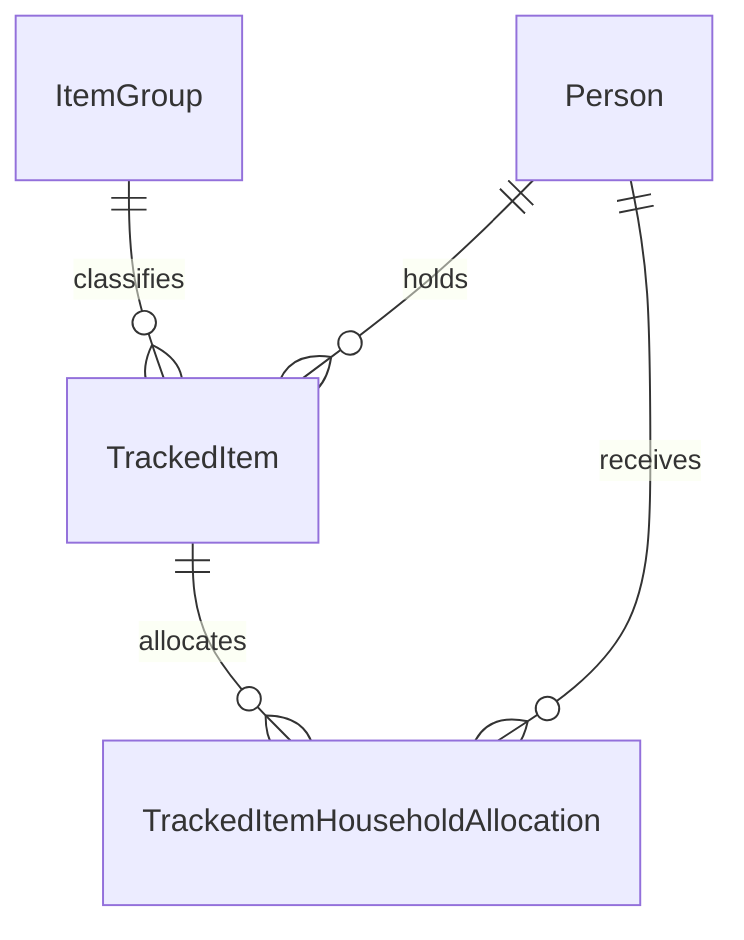

# Tracked items and household allocations

Implemented locally, 29 October 2026. This slice adds reusable item setup and
allocation rules. Values belong to the next Snapshot/ItemSnapshot slice; there
are no balance fields, conversions, summaries or new API endpoints here.

## Files to review

| File | Responsibility |
| --- | --- |
| [TrackedItem.cs](../backend/src/Hearthcast.Data/TrackedItems/TrackedItem.cs) | Item identity, holder, grouping, metadata, inclusion, retirement and allocation-set validation. |
| [TrackedItemHouseholdAllocation.cs](../backend/src/Hearthcast.Data/TrackedItems/TrackedItemHouseholdAllocation.cs) | One participating person's share of an included item. |
| [TrackedItemAllocationShare.cs](../backend/src/Hearthcast.Data/TrackedItems/TrackedItemAllocationShare.cs) | Input value containing a person ID and a share; it is not a database entity. |
| [TrackedItemService.cs](../backend/src/Hearthcast.Data/TrackedItems/TrackedItemService.cs) | Transactional creation and allocation replacement, plus retirement updates. |
| [TrackedItemConfiguration.cs](../backend/src/Hearthcast.Data/Persistence/Configurations/TrackedItemConfiguration.cs) | Item table, required metadata and same-household group/holder FKs. |
| [TrackedItemHouseholdAllocationConfiguration.cs](../backend/src/Hearthcast.Data/Persistence/Configurations/TrackedItemHouseholdAllocationConfiguration.cs) | Allocation key, share range and same-household item/person FKs. |
| [HouseholdService.cs](../backend/src/Hearthcast.Data/Households/HouseholdService.cs) | Additional guards against removing holders or excluding/removing allocation recipients. |
| [TrackedItemPersistenceTests.cs](../backend/tests/Hearthcast.Data.Tests/TrackedItems/TrackedItemPersistenceTests.cs) | Metadata, persistence, deletion, retirement and upgrade checks. |
| [TrackedItemAllocationTests.cs](../backend/tests/Hearthcast.Data.Tests/TrackedItems/TrackedItemAllocationTests.cs) | Allocation rules, replacement, participation, concurrency and rollback checks. |

## Tables and keys

TrackedItem has Id, HouseholdId, GroupId, HolderPersonId, Name, CurrencyCode,
CountryCode, IncludeInHousehold and IsRetired. It has a primary Id and an additional
unique `(HouseholdId, Id)` key. An ordinary item has one actual holder, implicitly
100%; there is no ordinary ItemHolder table.

The allocation table has HouseholdId, TrackedItemId, PersonId and ShareBasisPoints,
with primary key `(TrackedItemId, PersonId)`. It has no separate surrogate ID.

All group/holder/item/recipient references include HouseholdId in their foreign
keys. The required group and holder links establish the item's household; no
additional direct household FK is needed. Deletion is restricted throughout.
Asset/Debt is inherited through Group.Category; the item has no duplicate type.

Names are trimmed and nonblank. Currency codes are normalised to three uppercase
ASCII letters; country codes to two. These are format checks, not a live registry
of recognised currencies/countries. Country does not determine currency.

## Inclusion and allocation

- Excluded item: no allocation rows, regardless of who holds it.
- Included item: unique eligible recipients whose shares total exactly 10,000
  basis points, representing 100%. Each present share is 1 to 10,000; omit zeroes.
- 5,000 means 50%; 10,000 means 100%. Allocation recipients must currently
  participate in the same household's finances.
- When the service receives null allocations, an included item defaults to its
  holder at 100%; an excluded item defaults to an empty allocation set.
- An explicitly empty included allocation is invalid. It does not request defaults.
- A nonparticipating holder can hold an excluded personal item. Including their
  item requires an explicit allocation to eligible household participants.
- Allocation does not change the actual holder. A 50/50 split still represents
  one full item, rather than two separately recorded balances.

Replacement validates the entire new set before changing the tracked collection.
Existing recipient rows are updated in place, removed rows are deleted explicitly,
and new rows are added in one transaction. Invalid input leaves stored settings
unchanged. These operations do not provide a general item-details/reassignment API.
Names can be changed through the entity's Rename method.

## Participation, deletion and retirement

HouseholdService refuses to switch off or remove a person who receives current
allocations. Resolve or exclude those allocations first. A person who holds an
item cannot be removed while that holder reference remains.

An actual holder can stop participating after allocations have been assigned to
other eligible people, provided another household participant remains. Their
holder identity is retained. This distinguishes actual holdings from household
attribution.

Both allocation writes and participation/membership writes use fresh contexts
and serializable transactions. Their checks and updates are performed together,
so simultaneous allocation and participation changes cannot commit an ineligible
recipient through these services.

Retirement changes IsRetired without deleting identity or settings. It will remove
the item from new ordinary capture checklists in the snapshot slice. Retirement
does not automatically change household inclusion or clear allocations; retained
current allocations still require eligible participants.

The database enforces FK boundaries, required fields, code formats, boolean values,
unique recipients and individual share ranges. Allocation totals, inclusion/row
consistency and participant eligibility are transactional application rules.
Deliberately bypassing the services with raw SQL can bypass those cross-row rules.

## Migration and verification

The third migration, CreateTrackedItemsAndHouseholdAllocations, creates only the
two new tables and their indexes. It does not edit the first two migrations or
seed user data. Upgrade coverage verifies that existing people and classification
records survive; the full migration chain is also rolled back and reapplied.

At this checkpoint the SQLite suite passed 94 cases: the preceding 49 plus 22 tracked-item
persistence cases and 23 allocation cases. It covers personal/shared/excluded
items, metadata, same-household FKs, totals and ranges, replacement and exclusion,
participation/deletion guards, concurrent changes and creation rollback after a
failed allocation insert. All database files are isolated temporary test files.

The API still serves only `/health`; no persistent application database was
created or updated. This slice and the shared validation helpers are committed and pushed as
`3cb76ea`. The subsequent ordinary-snapshot capture/reload slice is documented
[separately](ordinary-snapshots-slice.md).
